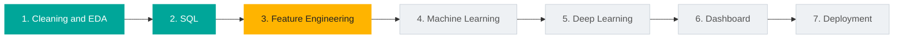

# 🏙️ Airbnb NYC Price Analysis | End-to-End Data Science Pipeline

**Dynamic Price Recommendation for Airbnb Hosts:** one dataset of New York City listings, taken stage by stage from raw data to a deployed model. Every stage has its own folder, code, slides and results.

> 📌 **Project 2 of my Data Science Pipeline** · by **Shailesh Pawar**
> 🔗 [LinkedIn](https://linkedin.com/in/shaileshpawar-cse) · 💻 [GitHub](https://github.com/Shailesh-Pawar-18)

## 🎯 The Problem
Hosts find it hard to price a listing fairly in New York City. The raw listing data is not ready for analysis or machine learning: it holds invalid prices (listings at $0), extreme values (prices up to $10,000 and minimum stays up to 1,250 nights), missing names and review fields, and a review date stored as text. Left as it is, these issues distort averages and hide the factors that really drive a listing's nightly price.

## 🧭 Project Objectives
1. Clean the 48,895-listing dataset and explore what drives nightly price.
2. Build a relational database and answer pricing and host-behaviour questions with SQL.
3. Engineer features and build a model that recommends a fair price for a listing.
4. Present the results in a dashboard and deploy the model as an app.

## 🛣️ Pipeline Roadmap



| Part | Stage | Tools | Status |
|---|---|---|---|
| 1 | [Data understanding, cleaning and EDA](part1-eda/) | Python, Pandas, Seaborn | ✅ Complete |
| 2 | [SQL analysis](part2-sql/) | MySQL, JOINs, subqueries, window functions | ✅ Complete |
| 3 | Feature engineering | Python, scikit-learn | 🔜 Next |
| 4 | Machine learning (price prediction) | scikit-learn | ⚪ Planned |
| 5 | Deep learning | TensorFlow / Keras | ⚪ Planned |
| 6 | Interactive dashboard | Power BI | ⚪ Planned |
| 7 | Deployment and final report | Streamlit | ⚪ Planned |

## 📊 Headline Results

| Metric | Value |
|---|---|
| Listings analysed | 48,631 (after cleaning 48,895 raw rows) |
| Median nightly price | **$105** (mean $141, so a few luxury listings skew the average) |
| Entire home / private room / shared room (median) | $160 / $70 / $45 |
| Manhattan vs Bronx (median) | $149 vs $65 |
| Premium segment | Manhattan entire homes, **$190 median** (about 1.8x the market) |
| Supply concentration | Manhattan and Brooklyn hold **85%** of listings |
| Host mix | **86%** of hosts have a single listing |
| Pricing behaviour | Multi-listing hosts price about **10% lower** ($131 vs $147 average) |

## 📌 Part 1: Cleaning and EDA
**Goal:** turn raw, messy listings into a validated, machine-learning-ready dataset, and find what drives price.

**Cleaning:** 48,895 rows became **48,631** (264 removed, 0.5%).

| Column | Issue | Action |
|---|---|---|
| name, host_name | 16 and 21 missing | Filled with "Unknown" |
| price | 11 listings at $0, 239 above $1,000 | Removed |
| minimum_nights | Up to 1,250; 14 listings above 365 | Removed |
| last_review | Text type, 10,052 missing | Converted to datetime; gaps kept (no reviews) |
| reviews_per_month | 10,052 missing | Filled with 0 |

**Findings:**
- Price is right-skewed: median $105, mean $141.
- **Room type is the strongest driver:** entire homes cost more than twice a private room.
- **Location is next:** Manhattan listings carry a clear premium.
- Numeric features are weak predictors; the strongest correlation with price is longitude (r = -0.26).
- 35.9% of listings are unavailable all year, and about 20% have never been reviewed.

📁 Notebook, slides and PDF are in [`part1-eda/`](part1-eda/).

## 📌 Part 2: SQL Analysis
**Goal:** load the cleaned data into a relational database and answer 10 business questions with SQL.

- **Schema:** `staging_listings` → `hosts` (37,270) and `listings` (48,631), linked by `host_id`. Host attributes are separated from listing attributes (second normal form).
- **Data quality:** 6 checks before any analysis.
- **Techniques:** `JOIN`, derived tables, scalar subqueries, `CASE`, `GROUP BY`, `HAVING`, and a window function (`ROW_NUMBER`).
- **Findings:**
  - 86% of hosts have one listing, and multi-listing hosts price about 10% lower.
  - Entire homes cost roughly 2.0 to 2.3 times a private room in every borough.
  - Revenue potential concentrates in professional operators such as Blueground, Sonder and Red Awning.
  - Premium hotspots: NoHo, SoHo and West Village.
  - Underpriced demand pockets exist, mostly Queens private rooms.
- **Engineering lesson:** a correlated subquery timed out on 48,631 rows; rewriting it as a derived table made it fast.

📁 SQL file, schema diagram and findings are in [`part2-sql/`](part2-sql/).

## 📂 Repository Structure
```
Airbnb-NYC-Price-Analysis/
│
├── README.md
├── requirements.txt
├── .gitignore
│
├── data/
│   ├── AB_NYC_2019.csv              raw data
│   └── cleaned_airbnb.csv           created by the Part 1 notebook
│
├── part1-eda/
│   ├── Part_1_EDA.ipynb
│   ├── Airbnb_NYC_Price_Analysis_EDA.pptx
│   └── Airbnb_NYC_Price_Analysis_EDA.pdf
│
├── part2-sql/
│   ├── README.md
│   ├── airbnb_sql.sql
│   └── schema_diagram.png
│
├── part3-feature-engineering/       (next)
├── part4-machine-learning/          (planned)
├── part5-deep-learning/             (planned)
├── part6-dashboard/                 (planned)
└── part7-deployment-report/         (planned)
```

## ▶️ How to Run

**Part 1 (Python)**
```bash
git clone https://github.com/Shailesh-Pawar-18/Airbnb-NYC-Price-Analysis.git
cd Airbnb-NYC-Price-Analysis
pip install -r requirements.txt
jupyter notebook part1-eda/Part_1_EDA.ipynb
```
Running the notebook creates `data/cleaned_airbnb.csv`.

**Part 2 (MySQL 8.0+):** open MySQL Workbench, run `part2-sql/airbnb_sql.sql` section by section, and change the file path in the import step to where `cleaned_airbnb.csv` is on your computer. Full steps are in [`part2-sql/README.md`](part2-sql/README.md).

## 📦 Dataset
NYC Airbnb Open Data, 2019: [dgomonov/new-york-city-airbnb-open-data on Kaggle](https://www.kaggle.com/datasets/dgomonov/new-york-city-airbnb-open-data). 48,895 listings and 16 columns: price (target), room type, borough, neighbourhood, coordinates, minimum nights, reviews, host listing count and availability.

## 🛠️ Tech Stack
Python · Pandas · NumPy · Matplotlib · Seaborn · Jupyter Notebook · MySQL · MySQL Workbench

## ⚠️ Limitations
- A 2019 snapshot of listing prices, not the prices guests actually paid.
- Estimated revenue in the SQL analysis uses days unavailable as a rough proxy for bookings.
- Rows above $1,000 a night and above 365 minimum nights were removed as extreme values, which is a judgment call.
- Findings are associations in the data, not proven causes.

---
## 👤 Author
**Shailesh Pawar**
🔗 [LinkedIn](https://linkedin.com/in/shaileshpawar-cse) · 💻 [GitHub](https://github.com/Shailesh-Pawar-18)

⭐ If you find this useful, star the repo and follow along for Chapter 3: Feature Engineering!
