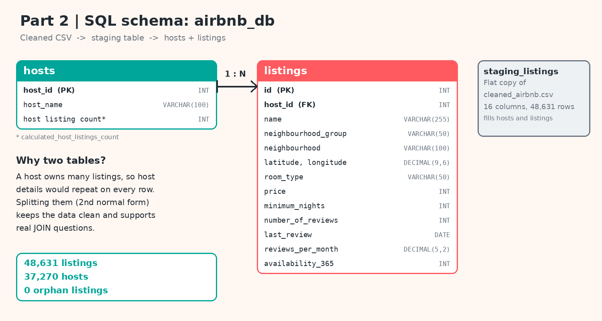

# Part 2: SQL Analysis | Airbnb NYC Price Analysis

> **The Airbnb Files, Chapter 2.** In Part 1 I cleaned the data and explored it with Python. In Part 2 I load it into a relational database and answer **10 business questions with SQL**.

## Business problem
Hosts struggle to price a listing fairly in New York City. Who prices above or below the market, where is demand strong but supply thin, and what do the most successful hosts do differently? This part of the project, "Dynamic Price Recommendation for Airbnb Hosts", answers those questions with SQL before any model is built.

## Objectives
1. Build a normalised MySQL database from the cleaned EDA data.
2. Check data quality before any analysis.
3. Answer 10 business questions with `JOIN`, subqueries, `CASE`, `GROUP BY`, `HAVING` and a window function.
4. Turn the results into pricing insights for hosts.

## Data
`data/cleaned_airbnb.csv` is the output of Part 1: **48,631 listings, 16 columns** (the NYC Airbnb 2019 open dataset, [on Kaggle](https://www.kaggle.com/datasets/dgomonov/new-york-city-airbnb-open-data)).

| Table | What it holds | Rows |
|---|---|---|
| `staging_listings` | Flat landing copy of the CSV | 48,631 |
| `hosts` | Host-level attributes: `host_id` (PK), `host_name`, `calculated_host_listings_count` | 37,270 |
| `listings` | Listing-level attributes, with `host_id` as a foreign key to `hosts` | 48,631 |

Host attributes were separated from listing attributes because they describe the host, not the listing (second normal form). This supports real `JOIN` questions.

## Files
| File | Purpose |
|---|---|
| `airbnb_sql.sql` | The full workflow: schema, import, verification, population, data quality checks, 10 business questions, executive summary |
| `schema_diagram.png` | Schema diagram |

## How to run (MySQL 8.0+)
1. Open **MySQL Workbench** and run Section 1 of `airbnb_sql.sql` to create `airbnb_db` and the three tables.
2. In Section 2, change the file path in `LOAD DATA LOCAL INFILE` to where `cleaned_airbnb.csv` is on your computer. If MySQL blocks the import, run `SET GLOBAL local_infile = 1;` first. (On Windows, use forward slashes in the path.)
3. Run the remaining sections in order.

**Check your setup**

| Check | Expected |
|---|---|
| Rows in `staging_listings` and `listings` | 48,631 |
| Rows in `hosts` | 37,270 |
| Orphan listings (no matching host) | 0 |
| Listings with a missing `last_review` | 9,911 (all have zero reviews) |

## Data quality checks (Section 4c)
Six checks ran before the analysis: missing values in key columns, non-positive prices, duplicate keys, unexpected room types, impossible coordinates, and unrealistic minimum stays. All passed on the cleaned data.

## The 10 business questions

| # | Question | Technique |
|---|---|---|
| Q1 | Power hosts vs solo hosts: who owns the market? | `JOIN` + `CASE` + `GROUP BY` |
| Q2 | Which listings are priced above their borough's average? | Derived table + `JOIN` |
| Q3 | How big is the room-type price premium in each borough? | `GROUP BY` on two dimensions |
| Q4 | Which 10 hosts have the highest estimated revenue potential? | `JOIN`, derived calculation, `LIMIT` |
| Q5 | Which listings are underpriced for their demand? | Derived table benchmark |
| Q6 | Which listings are overpriced for their borough and room type? | Derived table + `JOIN` |
| Q7 | Where are the high-demand, low-supply neighbourhood hotspots? | `GROUP BY` + `HAVING` + subquery benchmarks |
| Q8 | Do hosts with many listings price differently? | Scalar subquery + `CASE` |
| Q9 | What are the 3 most expensive listings in each borough? | Window function `ROW_NUMBER() OVER (PARTITION BY ...)` |
| Q10 | Who are the premium power hosts? | Non-correlated subqueries |

## Key findings
- **Most hosts are small.** 86% of hosts (32,122 of 37,270) have a single listing. The 5,148 multi-listing hosts price about **10% lower** on average ($131 vs $147), so scale does not mean premium pricing.
- **Room type sets the price in every borough.** Entire homes cost roughly 2.0 to 2.3 times a private room. Manhattan entire homes average about **$225**.
- **Borough averages differ widely.** Manhattan averages about $179 against $85 in the Bronx.
- **Revenue is concentrated in professional operators.** The highest estimated revenue potential belongs to corporate hosts such as Blueground, Sonder and Red Awning, not individuals. (Estimated revenue is price x days unavailable, a rough proxy.)
- **Underpriced demand pockets exist.** Most of the top 20 high-demand, below-average listings are Queens private rooms priced well under the $68 average for that segment.
- **Premium hotspots:** NoHo (about $276 average), SoHo ($254) and West Village ($239) combine high prices with below-average availability.

## What hosts and the platform can do
1. **Benchmark against borough and room type, not the city average.** The gap between segments is far larger than the gap within one.
2. **Review underpriced, high-demand listings.** They are the clearest room to raise prices.
3. **Watch the $995 to $1,000 Manhattan entire homes.** They show low turnover, so they may be overpriced.
4. **Treat professional operators as a separate segment** when analysing supply and revenue.

## What I learned
- **A correlated subquery timed out** on 48,631 rows, because it recalculated the borough average for every row. Rewriting it as a derived table that computes each average once, then joining, made it fast. (Q2, Q5 and Q6 use this pattern.)
- **`ROW_NUMBER()` vs `RANK()`:** prices are capped at $1,000, so ties are common. `ROW_NUMBER()` returns exactly 3 listings per borough, while `RANK()` can return more.

## Limitations
- "Estimated revenue" uses days unavailable as a proxy for bookings. Real bookings are not in the data.
- `reviews_per_month` is used as a demand signal, which is not the same as bookings.
- Prices are capped at $1,000 after cleaning, which affects the top of the range.
- These results show patterns in a 2019 snapshot, not proven causes.

## SQL skills shown
`CREATE TABLE` with primary and foreign keys · `LOAD DATA` · normalisation · `JOIN` · derived tables · scalar and non-correlated subqueries · `CASE` · `GROUP BY` · `HAVING` · window functions · data quality checks · query optimisation

## Next: Chapter 3
Feature engineering: turn what the EDA and SQL found into model-ready features for a price prediction model.

---
Author: **Shailesh Pawar** | [LinkedIn](https://linkedin.com/in/shaileshpawar-cse) | [GitHub](https://github.com/Shailesh-Pawar-18)
